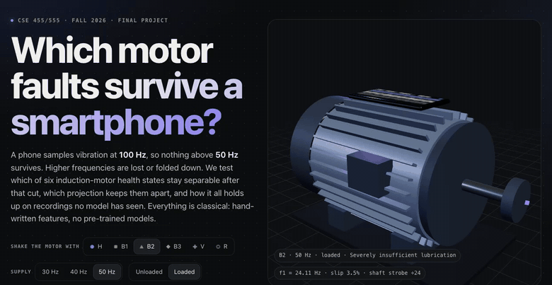
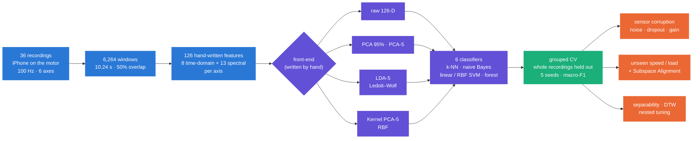
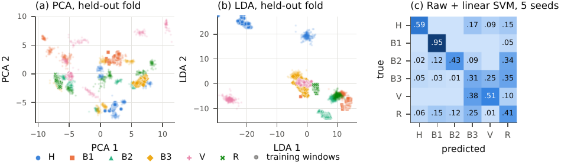
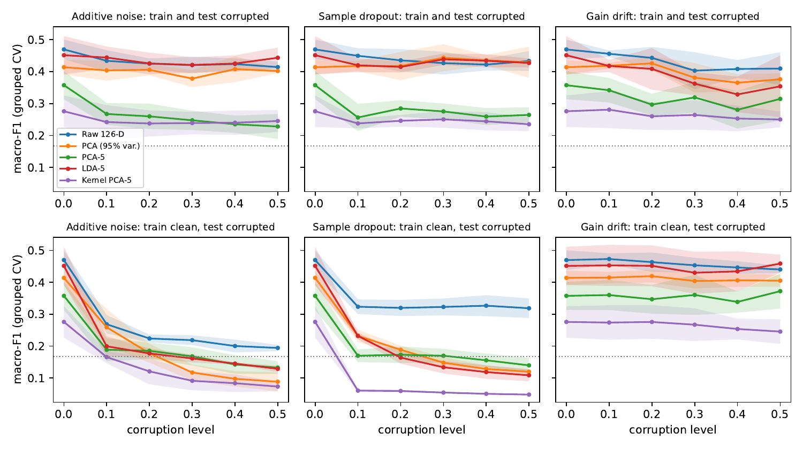
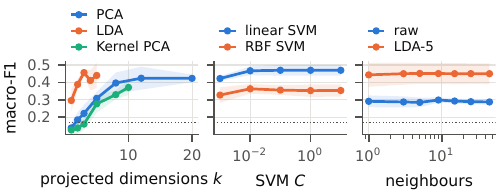
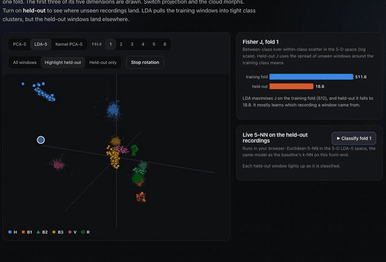
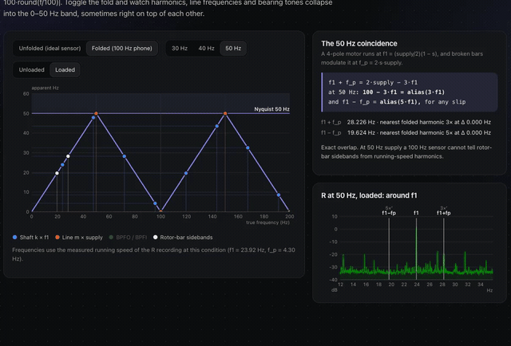
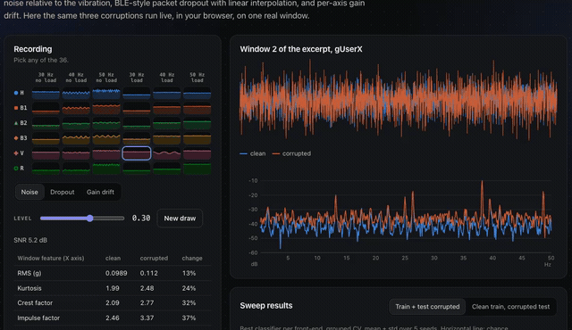
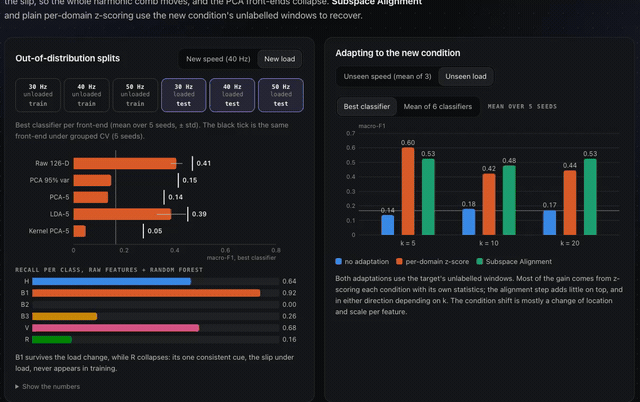

<div align="center">

# Bandwidth-Limited Pattern Recognition

### Which induction-motor faults survive a 100&nbsp;Hz smartphone sensor?




<sub>The interactive UI in <code>ui/</code>. A 3-D motor vibrates with a real recording, and the phone screen shows what the 100&nbsp;Hz sensor sees.</sub>

</div>

**CSE 455/555 Applied Pattern Recognition, Fall 2026.** Vaishak G Kumar, Sanika Vilas Najan.
Track option 2: dimensionality reduction against noise and out-of-distribution data.

A smartphone IMU samples at 100&nbsp;Hz, so nothing above 50&nbsp;Hz survives. This project measures three things:

- which of six motor health states (H, B1, B2, B3, V, R) stay separable after that cut;
- which projection (PCA, LDA, Kernel PCA) keeps them apart;
- how it all holds up under sensor corruption and in operating conditions no model has seen.

It is classical pattern recognition only: hand-written features, no pre-trained models.

## Results at a glance

| | |
|:--|:--|
| **1.00 → 0.47** | Macro-F1 with a random split over windows, against whole recordings held out. The best model is the linear SVM on raw features: 0.47 ± 0.03 over 5 seeds (chance 0.17). |
| **≈ 488 → 15** | LDA's Fisher J on its own training fold, against unseen recordings. LDA mostly learns *which recording* a window came from. |
| **B1 survives, R hides** | Lubrication loss survives through impulsiveness (recall 0.95). At 50&nbsp;Hz supply, the broken rotor bar's sidebands land exactly on aliased shaft harmonics. |
| **10 % noise** | Breaks models trained on clean data: the projected front-ends fall to 0.17–0.26, and Kernel PCA to chance or below. |
| **0.66 vs 0.14** | Macro-F1 on an unseen speed against an unseen load (the load figure is for the PCA front-ends). Z-scoring each condition separately recovers the unseen load to 0.60. |

## How it works



## What the 100 Hz sensor keeps

<p align="center"></p>

**(a, b)** PCA and LDA are fitted on one fold's training recordings (small dots). The large markers are the six held-out recordings: they land *beside* LDA's tight training clusters, not inside them. **(c)** The best model's confusion matrix, pooled over 5 seeds:

- **Lubrication loss (B1)** is recognised almost perfectly, through kurtosis, peak-to-peak and impulse factor. No defect frequency is needed.
- **The broken rotor bar (R)** is confused with severe lubrication loss (B2). Its sidebands fall at $f_1 + f_p = 100 - 3f_1$, the alias of the third shaft harmonic.
- **The cracked race (B3) and voltage imbalance (V)** live above Nyquist, so only weak, indirect cues remain.

## Noise and new operating conditions

<p align="center"></p>

**Top:** training and test data corrupted alike. Noise and dropout barely matter, and gain drift hurts LDA most.
**Bottom:** trained on clean data, tested on corrupted data. 10% noise or dropout is enough to collapse every projection.

| Unseen condition | Raw 126-D | LDA-5 | PCA 95% | PCA-5 | Kernel PCA-5 |
|---|:-:|:-:|:-:|:-:|:-:|
| New speed (train 30 + 50 Hz, test 40 Hz) | **0.66** | 0.60 | 0.54 | 0.52 | 0.32 |
| New load (train unloaded, test loaded) | **0.41** | 0.39 | 0.15 | 0.14 | 0.05 |

<sub>Best classifier per front-end, macro-F1, mean of 5 seeds.</sub>

## Only the projected dimension matters

<p align="center"></p>

- **Projected dimension:** PCA rises from 0.14 at k = 1 to 0.42 at k ≥ 12, and Kernel PCA reaches 0.37 at k = 10. LDA peaks at k = 3 (0.46).
- **Other hyperparameters:** the linear SVM is flat for C ≥ 0.01, and the neighbour count barely moves k-NN.
- **Nested grouped tuning:** it moves the linear front-ends by at most ±0.04, which is inside the fold-to-fold spread.

## Interactive UI

| Feature space: held-out recordings and a live 5-NN | Aliasing: the spectrum folds at 50&nbsp;Hz |
|:-:|:-:|
|  |  |
| **Robustness lab: corrupt a recording live** | **Unseen speed vs. unseen load** |
|  |  |

`ui/` is a single-page site that walks through the whole project:

- the motor and its fault signatures, and all 36 recordings with live spectra;
- aliasing and the validation protocol;
- a 3-D view of the PCA / LDA / Kernel PCA feature spaces;
- separability and the model grid;
- corruptions, and unseen speeds and loads with Subspace Alignment;
- DTW and tuning.

It reads one data bundle exported from the results below:

```bash
python scripts/export_ui_data.py       # needs the feature cache and results/ (one core, a few seconds)
cd ui && npm install && npm run dev    # http://localhost:5173
```

`npm run build` writes a static site to `ui/dist/`, and `npm run preview` serves it.

- **In the browser:** the k-NN, corruption, DTW and spectrum demos run in the browser on the exported windows. Animations pause when they are off screen.
- **Seeds:** the model grid, corruption sweeps, OOD splits and Subspace Alignment show mean ± std over every seed the export finds, either the per-seed result folders or a copied `results/multiseed/`. A table with only one seed is labelled "seed 0".
- **No WebGL:** the two 3-D views fall back to 2-D canvases. Add `?webgl=0` to the URL to force it.

## Presentation and report

- **Slides:** [`presentation/Motor_Fault_Slides.html`](presentation/) is 11 slides in one offline HTML file. Download it and open it in a browser. Press **N** for speaker notes and **F** for fullscreen.
- **Report:** `report/` holds the 4-page IEEE report. Build it with `cd report && latexmk -pdf main.tex`.

## Setup

```bash
python -m venv .venv && source .venv/bin/activate
pip install numpy scipy pandas pyarrow scikit-learn matplotlib pytest
python scripts/download_data.py        # 36 CSVs (~190 MB) -> data/raw/
```

## Run

Everything below regenerates every number, table and figure in the report from the raw data.

```bash
# 1. features (cached) + the clean model grid, seed 0
python scripts/run_baseline.py                   # -> results/baseline/

# 2. every experiment over 5 seeds (seed 0 -> results/<name>/, seed k -> results/<name>_seed<k>/)
for s in 0 1 2 3 4; do
  [ $s -gt 0 ] && python scripts/run_baseline.py --seed $s
  python scripts/run_corruption.py --corrupt both --seed $s   # train + test corrupted
  python scripts/run_corruption.py --corrupt test --seed $s   # train clean, test corrupted
  python scripts/run_ood.py --seed $s                         # cross-speed / cross-load splits
  python scripts/run_sa.py --seed $s                          # Subspace Alignment vs controls
done
python scripts/aggregate_seeds.py                # mean ± std over seeds -> results/multiseed/

# 3. separability analysis, DTW and nested tuning (seed 0)
python scripts/run_analysis.py                   # -> results/analysis/
python scripts/run_dtw.py                        # -> results/dtw/
python scripts/run_tuning.py                     # -> results/tuning/
python scripts/run_hyper.py                      # macro-F1 vs k, SVM C, neighbours (5 seeds) -> results/hyper/, fig_hyper.pdf

# 4. report tables and figures, then the PDF
python scripts/make_report_figures.py            # separability, DTW, Kernel PCA, projection + confusion figures; tables
python scripts/make_methods_tables.py            # model grid, splits, OOD, SA tables; corruption figure
(cd report && latexmk -pdf main.tex)             # report/main.pdf

python scripts/export_ui_data.py                 # data bundle for the interactive UI -> ui/public/data/
python -m pytest                                 # tests
```

**Feature cache.** `run_baseline.py` caches features at `data/processed/features_clean.parquet`. Run it once before anything else, because every other script reads that cache (the corruption sweeps re-extract features from the corrupted signal). Delete the cache after changing feature or windowing code.

**Cores and resuming.** The corruption sweeps and `run_sa.py` run their cells in parallel (`--n-jobs`, default all cores). `run_dtw.py` and `run_tuning.py` use one or two cores and save partial results, so an interrupted run resumes where it stopped.

**Seeds.** A seed changes the grouped fold assignment, the random-forest seed, the Kernel PCA subsample and the corruption noise.

**Reproducibility.** Results can differ slightly between machines, because near-ties in the tuning grid search can flip, so the report's numbers all come from one run. Each results folder gets a `runlog.json` with the seed, parameters, library versions and dataset version.

**Runtime.** On a 16-core node the whole sequence takes about an hour; on a laptop, several hours.

## Layout

| Path | Contents |
|---|---|
| `src/motorpr/data.py` | Loading, 1024-sample windows (50% overlap), per-window DC removal |
| `src/motorpr/features.py` | 21 time/frequency features per channel × 6 channels = 126 |
| `src/motorpr/corruption.py` | Noise, dropout and gain drift on raw recordings |
| `src/motorpr/projections.py` | Hand-written PCA, LDA (Ledoit–Wolf) and Mahalanobis whitening |
| `src/motorpr/evaluation.py` | Recording-grouped CV, model grid, metrics, separability |
| `src/motorpr/kernel_pca.py` | Hand-written RBF Kernel PCA front-end (`kpca5`) |
| `src/motorpr/analysis.py` | Held-out pair Fisher scores, rotor-bar sideband and aliasing checks |
| `src/motorpr/dtw.py` | Window envelopes and DTW k-NN |
| `src/motorpr/tuning.py` | Nested recording-grouped hyperparameter tuning |
| `src/motorpr/domain.py` | Subspace Alignment and per-domain z-scoring for unseen operating conditions |
| `scripts/` | Download and experiment entry points |
| `report/` | Report figures, tables and section sources |
| `ui/` | Interactive project site (React, Three.js); data from `scripts/export_ui_data.py` |
| `presentation/` | Slide deck (single HTML file) and its source |
| `docs/` | README figures and UI captures |
| `tests/` | Unit tests on synthetic signals |

## Validation

Overlapping windows from one recording are highly correlated, so every reported result uses cross-validation grouped by recording. A naive random split is reported only to show the leakage. On clean data it scores about 1.00 macro-F1. Grouped splits give 0.15–0.47 (mean of 5 seeds), and leaving one operating condition out gives at most 0.56.

## Data

Ertarğın, M., Orhan, A., Yıldırım, Ö., Chauhan, S., & Vashishtha, G. (2026). A smartphone-based vibration dataset for induction motor fault diagnosis under different speed and load conditions. *Data in Brief, 67*, 112916. https://doi.org/10.1016/j.dib.2026.112916

The data is at https://doi.org/10.17632/rs4vz8n3t5 (CC BY 4.0). It is not redistributed here; use the download script.
